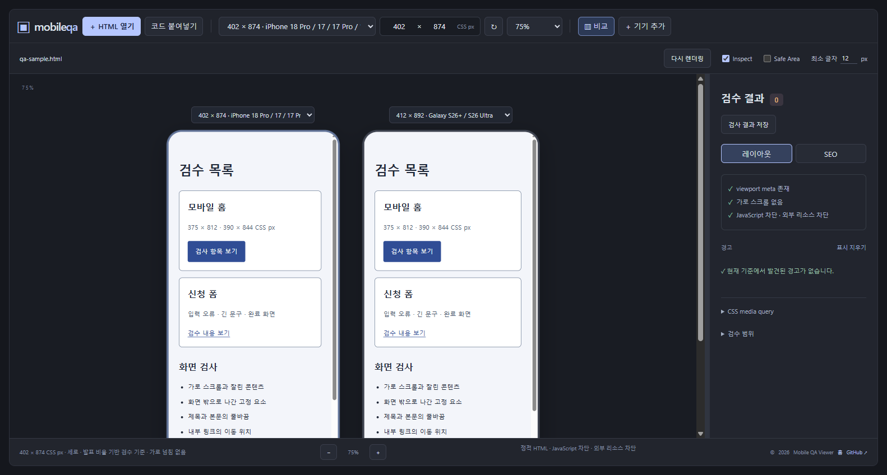
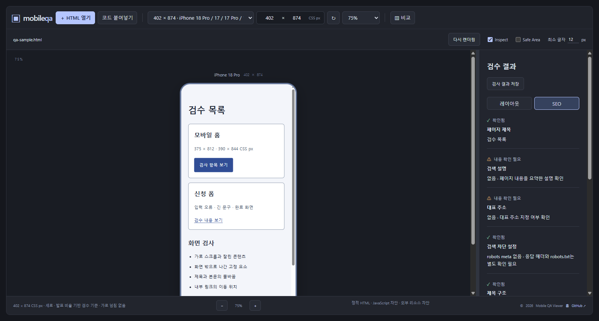

# Mobile Content QA Viewer

HTML 파일과 코드를 화면 크기별로 확인하는 로컬 검수 도구.



## 실행

Node.js 24.22.1 이상(24.x) 권장. [전체 지원 버전](docs/Design.md#실행과-서버).

```sh
npm start
```

실행 주소: [http://127.0.0.1:4173](http://127.0.0.1:4173)

## 사용

1. HTML 파일 열기 또는 코드 붙여넣기.
2. 기기 또는 직접 입력으로 화면 크기 선택.
3. 레이아웃·SEO 확인 후 검사 결과 JSON 저장.

- iPhone·Galaxy 프로필과 같은 크기 모델 통합.
- 2–4개 기기 비교·회전·자동 맞춤 지원.
- 하단 −/+로 확대·축소, 패널 경계 드래그로 너비 조절.
- 가로 넘침·콘텐츠 잘림·작은 글자·깨진 내부 링크·이미지 실패·media query 확인.
- Safe Area 참고 표시와 경고 요소 강조.
- 직접 입력 범위: 가로·세로 240–2048 CSS px. [기기 크기 기준](docs/devices.md).

## SEO 검사

- 페이지 제목·검색 설명·대표 주소.
- 검색 차단 meta·제목 구조.
- 이미지 대체문구·공유 정보.
- JSON-LD 문법·문서 언어.
- 현재 HTML의 검사 결과 JSON 저장.



## 사용 범위

- 정적 HTML·인라인 CSS 미리보기. 현재 데스크톱 브라우저 기준.
- JavaScript·외부 통신·중첩 프레임·폼 전송 차단.
- 내부 링크·펼치기 등 브라우저 기본 HTML 동작 지원.
- 원본·초안·현재 결과는 메모리에만 보관. 새로고침 시 초기화.
- HTML 최대 2MB.
- URL 열기·JavaScript 실행·브라우저 자동화·이미지 촬영 미지원.
- 사이트 전체 SEO 수집·검색 순위·AI 노출 평가 미지원.

프로젝트 외부 의존성 없음. 최신 브라우저 사용 권장.

[설계·실행 설정](docs/Design.md) · [작업 상태·검증 기록](PLAN.md) · [작업 원칙](AGENTS.md)
